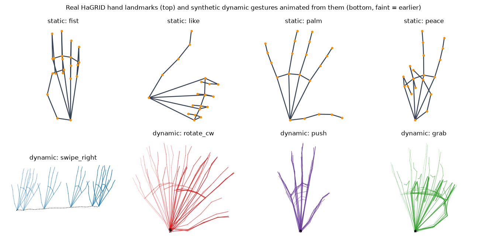
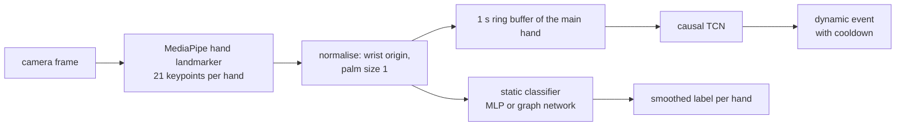

# Hand gesture recognition

Real-time recognition of **static** hand gestures (33 HaGRID gestures + "no gesture") and
**dynamic** gestures (swipes, push/pull, rotations, grab/release) from a webcam. The pipeline
works on hand keypoints: MediaPipe finds 21 landmarks per hand, and small networks classify
them. That costs ~10 ms per frame on a laptop CPU. An end-to-end YOLO detector trained on the
same photos is the comparison baseline.

<p align="center"></p>
<sub>Free stock clips from Pexels, run frame by frame: MediaPipe finds the 21 hand points and the
static MLP names the gesture. Like turning into dislike and stop turning into ok show how quickly
it follows a change.</sub>





## What is in it

- **Static gestures on ~1M real hands.** HaGRID v2 ships 21 landmarks for every hand. The
  landmark classifiers therefore train on the 719 MB annotations instead of 1.5 TB of photos.
  The test set is HaGRID's held-out *people*. Two models are compared:
  - an MLP on engineered features (normalised coordinates, fingertip distances, 15 joint angles),
  - a graph convolutional network that learns along the bones of the hand skeleton.
- **Dynamic gestures without a dynamic dataset.** Real HaGRID hand shapes are animated with
  minimum-jerk motion: swipes, push/pull, rotations, and grab/release (palm morphing into a fist).
  They are then corrupted like a live detector would corrupt them: jitter, dropped frames,
  random handedness, position and size. A **causal** temporal convolutional network (no look
  into the future, verified by a unit test) classifies 1 s windows. The same network runs on
  the live stream. `hg-record` collects real webcam windows as the honest test set.
- **Two paradigms, same photos.** `hg-compare` evaluates keypoints → classifier against a YOLO26
  detector trained end-to-end on a HaGRID photo subset. Both run on people unseen in training,
  and the comparison reports hand recall, gesture accuracy and latency. The photo subset is
  pulled from the 128 GB archive with HTTP range requests (only the chosen files). YOLO26 is
  the newest Ultralytics detector; it runs with its NMS-free head (`nms=False`), so its latency
  is the whole detector and not detector + NMS.
- **Deployment.** ONNX export of both networks with a parity check. The live demo shows
  skeletons, labels, events and FPS.

## Results

| Model | Input | Test accuracy (unseen people) | Macro-F1 |
|---|---|---|---|
| MLP | engineered landmark features | **95.8 %** | 0.962 |
| Graph network | raw skeleton | 93.5 % | 0.939 |

| Comparison on held-out photos | Hand recall | Gesture accuracy | CPU ms / image |
|---|---|---|---|
| MediaPipe keypoints + MLP | 90.7 % | 86.1 % | **28** |
| YOLO26s detector | **99.6 %** | **99.3 %** | 41 |

4080 held-out HaGRID photos with 5652 hands, both pipelines on the same 8-core CPU node. The
detector finds almost every hand and names its gesture correctly 99 % of the time; MediaPipe
misses about one hand in ten (small, blurred or cut-off hands), and every miss is a wrong
gesture. The keypoint pipeline is the faster one on a CPU and gives the skeleton that the
dynamic gestures need, so it stays the live demo; the detector is the choice when accuracy on
single photos matters.

| Dynamic model | Held-out synthetic sequences |
|---|---|
| causal TCN | 99.96 % |
| GRU | 99.94 % |

Own recordings can be added with `hg-record` and are scored after training (see the quickstart).

## Quickstart

```bash
pip install -e ".[train]"
bash scripts/download.sh                      # hand model, HaGRID landmarks (+ photo subset for YOLO)
hg-train-static --config configs/static_mlp.yaml --set data.path=data/hagrid/landmarks.npz
hg-train-dynamic --config configs/dynamic_tcn.yaml --set data.landmarks=data/hagrid/landmarks.npz
pip install opencv-python                     # GUI build for the live window
hg-demo --static runs/static_mlp/best.pt --dynamic runs/dynamic_tcn/best.pt --source 0 --show
hg-record --out data/recordings.npz           # your own labelled dynamic gestures
```

## Training on a GPU cluster (Slurm)

```bash
bash scripts/setup_cluster.sh && bash scripts/download.sh     # login node
python3 slurm/generate.py train-static --submit            # array: MLP, graph network
python3 slurm/generate.py train-dynamic --submit           # array: TCN, GRU
python3 slurm/generate.py train-detector --submit          # YOLO26s on the photo subset
python3 slurm/generate.py compare --submit
```

## Project layout

```
src/hand_gestures/
  landmarks.py        skeleton layout, normalisation, features, augmentation (rotation, aspect, mirror, jitter)
  models.py           MLP, hand-skeleton GCN, causal TCN, GRU
  synth.py            minimum-jerk animation of real hand shapes into dynamic gestures
  train_static.py     subject-disjoint training and per-class report
  train_dynamic.py    on-the-fly synthetic training, evaluation on real recordings
  engine.py, demo.py  real-time pipeline: MediaPipe -> classifiers -> smoothing and events
  record.py           webcam recorder for a real test set
  compare.py          keypoints vs. YOLO on held-out photos
  data/               HaGRID landmarks -> .npz; photo subset via range requests -> YOLO format
tests/                normalisation, causality, motion directions, training on real HaGRID landmarks, ONNX export
```

## Data

HaGRID (Kapitanov et al., WACV 2024) and its extension HaGRIDv2 (Nuzhdin et al., arXiv:2412.01508,
2024) are licensed under a CC BY-SA 4.0 variant. `tests/fixtures/hagrid_small.npz` contains 360 hand landmark sets from it.
